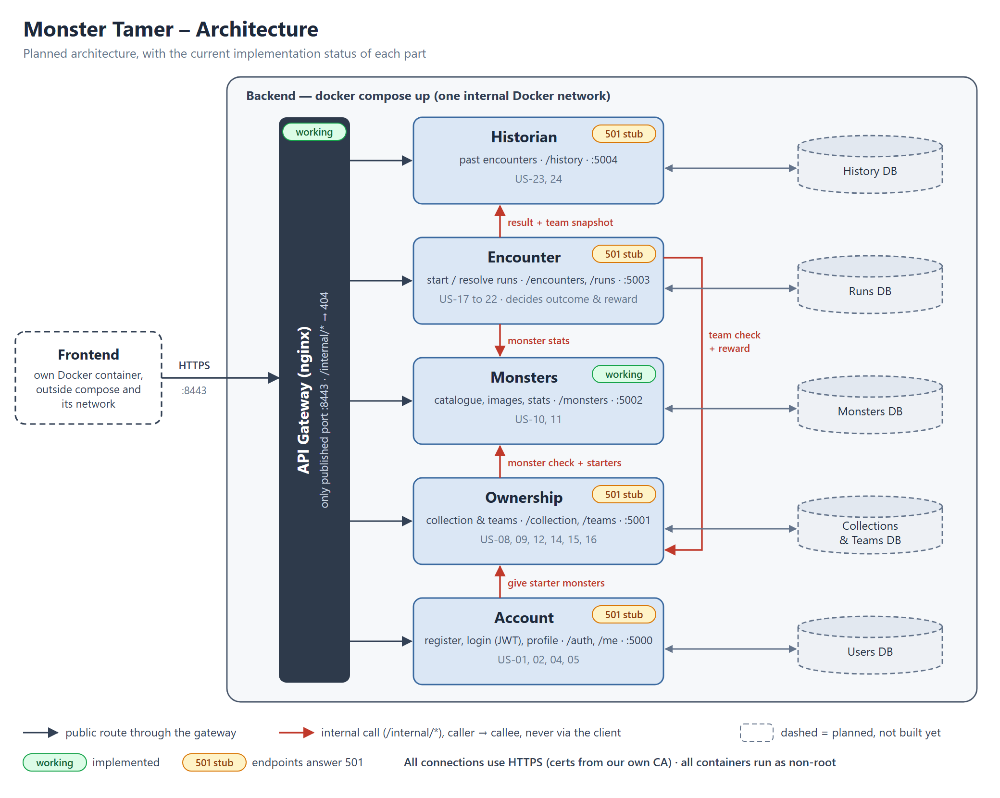

# Monster-Tamer

Final project for the UNIPI ASE 26/27 course. Its a monster collecting game: you get some starter monsters, build a team, send it into encounters and if you win you get a new monster. The backend is 5 microservices behind an HTTPS API gateway, started with docker compose.

This is the state for the second optional submission (15 Nov). Short version: the infrastructure works, most of the game logic is still to do. Details below.

## 1. Group

Group name: Unnamed

| Name | Surname | Email |
|---|---|---|
| Klevi | Xhani | k.xhani1@studenti.unipi.it |
| Laiba | Tanveer | l.tanveer@studenti.unipi.it |
| Giacomo | Fagiuoli | g.fagiuoli@studenti.unipi.it |

## 2. Architecture



Some notes on it:

- the gateway is the only thing you can reach from outside, on https://localhost:8443
- everything talks HTTPS, also gateway -> service. We have our own CA and each service has its own certificate, the gateway checks them
- anything under `/internal/` is for service to service calls, the gateway answers 404 if you try from outside
- one Postgres database per service, each on its own private network so only its owner can reach it. monsters-db is done, the others are coming
- frontend will be a separate docker container outside compose, talking only to the gateway (not there yet either)

Who does what:

| Service | Port (inside docker) | Paths on the gateway | What its for |
|---|---|---|---|
| account | 5000 | `/auth`, `/me` | register, login, profile |
| ownership | 5001 | `/collection`, `/teams` | monsters you own and your teams |
| monsters | 5002 | `/monsters` | list of all monsters in the game + stats |
| encounter | 5003 | `/encounters`, `/runs` | start and resolve encounters |
| historian | 5004 | `/history` | past encounters |

## 3. OpenAPI

All in `docs/`:

- [gateway.yaml](docs/gateway.yaml): the API the clients see on https://localhost:8443. It has the gateway's own `/health`, and every other path is a `$ref` to the service spec that implements it, so the two can't drift apart. `/internal/*` paths are not in it because the gateway blocks them
- [account.yaml](docs/account.yaml)
- [ownership.yaml](docs/ownership.yaml)
- [monsters.yaml](docs/monsters.yaml)
- [encounter.yaml](docs/encounter.yaml)
- [historian.yaml](docs/historian.yaml)

The service specs also describe the `/internal/*` endpoints used for service to service calls.

Only monsters can actually be tested right now, the others are the design we are implementing.

## 4. Implementation status

Works:

- `docker compose up` starts gateway + 5 services, all with healthchecks
- HTTPS everywhere with self signed certs (script in `certs/`)
- gateway routing to all 5 services, `/internal/*` blocked
- containers run as non root user
- monsters service (#35): the 15 monsters of `seed/monsters.json` and their images are validated and loaded into its own Postgres database (monsters-db) at startup. `GET /monsters` (with `element`/`rarity` filters), `GET /monsters/{id}`, `GET /monsters/{id}/image`, `/internal/monsters?ids=...` and `/internal/starters` read from it
- monsters-db: TLS only (certificate checked by the service), password as a Docker secret, data in a named volume, container runs as the `postgres` user
- CI on github actions: unit tests, bandit, pip-audit, trivy on the images, and a smoke test that starts everything and calls the gateway

Designed but not implemented (the endpoints just answer 501 for now):

- account, ownership, encounter, historian
- game rules: [docs/game-rules.md](docs/game-rules.md)
- how an encounter is resolved: [docs/EncounterRules.md](docs/EncounterRules.md)
  
Missing:

- databases for account, ownership, encounter and historian
- register / login / JWT, so no auth checks anywhere yet
- the frontend
- Bruno tests and Locust

Next thing we are doing is account (register + login) and then ownership, so that the loop register -> starters -> team -> encounter -> history works.

## 5. How to run

You need Docker with compose v2, plus bash and openssl for the cert script (on windows use git bash or WSL).

```bash
git clone https://github.com/Klevix9/Monster-Tamer.git
cd Monster-Tamer
./certs/generate-certs.sh
docker compose up --build
```

The cert script only needs to run the first time. It makes `certs/out/` (not in git) with the certificates and the random database passwords. Running it again keeps the existing passwords; if you ever delete `certs/out/`, also run `docker compose down -v` so the databases are recreated with the new passwords. Gateway is then on https://localhost:8443. Stop with ctrl+c or `docker compose down`.

Frontend: nothing to run yet.

## 6. How to test

With the backend running, from the repo folder:

```bash
# gateway is alive -> {"status":"ok"}
curl --cacert certs/out/ca.crt https://localhost:8443/health

# list of monsters
curl --cacert certs/out/ca.crt https://localhost:8443/monsters

# only dark monsters
curl --cacert certs/out/ca.crt "https://localhost:8443/monsters?element=dark"

# one monster with stats
curl --cacert certs/out/ca.crt https://localhost:8443/monsters/mon-001

# its image
curl --cacert certs/out/ca.crt https://localhost:8443/monsters/mon-001/image -o mon-001.png

# monster that doesnt exist -> 404
curl --cacert certs/out/ca.crt https://localhost:8443/monsters/nope

# internal paths are blocked -> 404
curl --cacert certs/out/ca.crt https://localhost:8443/internal/monsters

# the other services answer but are not implemented -> 501
curl --cacert certs/out/ca.crt -X POST https://localhost:8443/auth/register
curl --cacert certs/out/ca.crt https://localhost:8443/collection
curl --cacert certs/out/ca.crt https://localhost:8443/encounters
curl --cacert certs/out/ca.crt https://localhost:8443/history
```

The `--cacert` part is needed because the certificate is self signed.

Unit tests, per service (example with monsters):

```bash
cd services/monsters
python -m venv .venv && source .venv/bin/activate
pip install -r requirements.txt -r requirements-dev.txt
python -m pytest
```

The same checks run in CI on every pull request, see `.github/workflows/ci.yml`.

## 7. Other stuff

Things we know are not great yet:

- some numbers in the game rules are still "tbd"
- service to service calls are not authenticated yet, they are only protected by the gateway blocking `/internal`

Questions we have, feedback on these would help a lot:

1. For OAuth2 is the password grant on `/auth/token` ok or do you expect a different flow?
2. "Sensitive data encrypted in the db": is that only the password hashes?
3. The gateway spec references the service specs with `$ref` instead of copying them. Is that ok, or do you want one self contained file?
